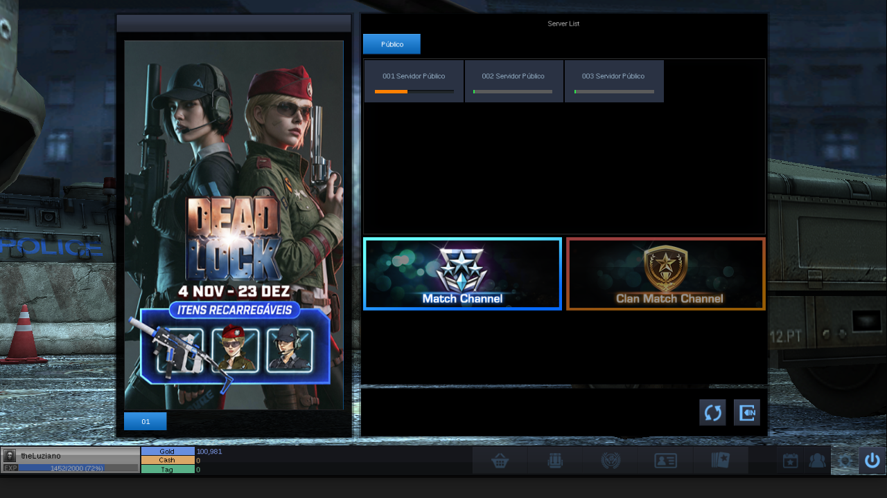

# Point Blank (Zepetto BR) no Linux — via Wine

Instalador e runtime para rodar o cliente **Windows** do Point Blank no Linux
com o **instalador oficial** e três correções de compatibilidade no ambiente
(Wine/DXVK) — sem tocar no binário do jogo.



Testado em **Linux Mint 22.3 (Cinnamon, X11)**, kernel 6.14, NVIDIA GTX 1060
(580.178), Wine 9.0 compilado, DXVK 1.10.3.

---

## Estado

| Item | Situação |
|---|---|
| Instalação pelo instalador oficial (16 volumes, ~14 GB) | ✅ silenciosa, numa pasta escolhida |
| Launcher + WebView2 + patch automático (~427 MB) | ✅ |
| Login / CheatBlocker / XignCode3 | ✅ |
| Lobby, canais, sala e partida (3D, rede) | ✅ jogável |
| Texto (nomes de servidor, nick, HUD, mensagens) | ✅ legível |
| Tela cheia / borderless / janela | ✅ os três |
| Limite de FPS (AUTO ou custom) | ✅ |
| Efeitos `Effect/H/*` ausentes | ⚠️ 6 avisos cosméticos por execução |

## As três correções

O cliente em si funciona no Wine; o que quebrava era o ambiente. Cada problema
foi isolado e corrigido fora do jogo:

| # | Sintoma | Causa | Correção |
|---|---|---|---|
| 1 | Crash `C0000005` em `movaps` na entrada (1 em 3–5 tentativas) | heap 32-bit do Wine alinha o bloco TLS a 8 bytes; o jogo usa SSE e exige 16 | patch em `dlls/ntdll/loader.c` (aloca 16-alinhado e guarda o ponteiro bruto) |
| 2 | Texto com letras trocadas (`& DCOO0 D#KP DNQJ`) | `ScriptTextOut` não inicializa um `SCRIPT_CACHE` vazio e desenha **índices de glifo como códigos de caractere** | patch em `dlls/gdi32/uniscribe/usp10.c` (chama `init_script_cache` quando `*psc == NULL`) |
| 3 | Crash `C0000005` em `d3d11.dll +0x9E4B` | o cliente chama `ExecuteCommandList(NULL)`; o DXVK não valida o ponteiro | patch de 16 bytes no `d3d11.dll` do DXVK (no-op quando nulo) |

Detalhes técnicos, evidências e como reproduzir: [`docs/correcoes.md`](docs/correcoes.md).

Também há a ponte **HTTP→HTTPS** (o launcher fala HTTP puro na porta 443; o
WinHttp do Windows promove para TLS, o do Wine não): `runtime/pb-bridge.py` +
regras de `iptables` que redirecionam só os IPs do patch server para a ponte
local.

## Requisitos

- Linux x86_64 com X11 (Wayland não testado) e GPU com Vulkan
- `zenity`, `python3`, `xz`, `iptables`, `systemd`, `sudo`, `curl`
- ~16 GB livres (jogo ~14 GB + prefixo ~2,4 GB)
- Instalador oficial: `PointBlank_SetupFull_*.exe` **e os 16 `*-XX.bin`** na
  mesma pasta (obtidos no site oficial da Zepetto)

## Instalação

```bash
git clone https://github.com/luizcasemiro/zepetto-pointblank-on-linux.git
cd zepetto-pointblank-on-linux

./scripts/preparar-payload.sh   # baixa WebView2 + DXVK (e avisa do Wine)
./instalar.sh
```

O instalador pergunta apenas:

1. o **`.exe` do instalador oficial**;
2. a **pasta de destino** do jogo (ex.: `~/Games/PointBlank`);
3. a **senha do sudo** (iptables + serviço da ponte).

E faz o resto sozinho: Wine corrigido → prefixo → WebView2 → instalador oficial
(`/VERYSILENT /DIR=...`) → `C:\PointBlank` → fontes do jogo → DXVK + patch →
serviço da ponte → config gráfica → **atalho na área de trabalho**.

### O Wine corrigido

O pacote **não versiona** o Wine compilado (~250 MB, preso à glibc/X11 da
distro). Duas opções:

```bash
./scripts/construir-wine.sh     # compila o Wine 9.0 com os patches (~30–60 min)
```

ou coloque um `payload/wine-tls.tar.xz` pronto (gerado por esse mesmo script em
outra máquina compatível).

## Uso diário

- Atalho **Point Blank** na área de trabalho / menu de aplicativos
- ou `~/.local/share/pb/pb-run.sh`

```bash
PB_BACKEND=wined3d      ~/.local/share/pb/pb-run.sh   # fallback sem DXVK
PB_GAME_DIR=/outro/lugar ~/.local/share/pb/pb-run.sh  # outra pasta de jogo
```

O log da última execução fica em `~/.local/share/pb/ultima-execucao.log`.

## Estrutura

```
instalar.sh                 # instalador (zenity)
desinstalar.sh              # remove o que foi criado
scripts/preparar-payload.sh # baixa WebView2 + DXVK
scripts/construir-wine.sh   # compila o Wine 9.0 com os patches
payload/patches/            # os 3 patches + script do DXVK
runtime/pb-run.sh           # o que o atalho chama
runtime/pb-bridge.py        # ponte HTTP->HTTPS do patch server
runtime/iptables-pb.sh      # regras 443 -> 8443
runtime/systemd/            # serviços pb-bridge e pb-iptables
templates/                  # env_settings.ini e fontconfig
docs/correcoes.md           # engenharia das três correções
```

## Solução de problemas

**"A ponte HTTP->HTTPS não subiu"**
```bash
systemctl status pb-bridge pb-iptables
journalctl -u pb-bridge -n 50
sudo ~/.local/share/pb/iptables-pb.sh
```
A ponte escuta em `127.0.0.1:8443`; as regras redirecionam só os IPs de
`patch-br.zepetto.com` e `patch-br-1.zepetto.com`.

**Launcher fecha sozinho / "Runtime not installed"**
Falta o WebView2: `./scripts/preparar-payload.sh` e rode o instalador de novo.

**Texto voltou a ficar trocado**
Você trocou o Wine por um sem o patch. Use `~/.local/share/pb/wine-tls/bin/wine`
(ou recompile com `scripts/construir-wine.sh`).

**Crash em `d3d11.dll` depois de atualizar o DXVK**
O patch se perde na atualização. Reaplique:
```bash
python3 ~/.local/share/pb/patch-dxvk-null-cmdlist.py \
        ~/.wine-pb/drive_c/windows/syswow64/d3d11.dll
```

**Sem imagem / crash no boot em DirectX 9**
A config usa DX11 (`DXVersion=11`). DX9 quebra a compilação de shader no Wine.
Confira `EnvSet/env_settings.ini`.

**FPS / tela cheia**
A config inicial usa tela cheia na resolução nativa detectada e limite de
120 FPS. Ajuste na engrenagem do launcher (Resolution / FPS / Screen:
*Fullscreen*, *Windowed Fullscreen* ou *Windowed*).

## Desinstalar

```bash
./desinstalar.sh
```
Remove atalhos, serviços, scripts e prefixo. A pasta do jogo só é apagada se
você confirmar.

## Licença e aviso

Código deste repositório: **MIT** (ver `LICENSE`). Os patches são derivados do
Wine 9.0 (LGPL-2.1-or-later). **Nenhum arquivo do jogo é distribuído** aqui: o
instalador exige o instalador oficial, e as fontes usadas pelo Wine são copiadas
do próprio jogo já instalado.

Isto não é um port oficial. O cliente roda com o anti-cheat original e nenhum
patch é aplicado no binário do jogo nem no processo em execução — mas rodar fora
do Windows é por sua conta e risco, e pode contrariar os termos de uso do jogo.
